# See

See is a C workbench that runs entirely in your browser. You write C the way the classic
books teach it, press F5, and the program stops at the first line of `main`. Then you go
one line at a time and watch the memory: every call gets a frame on the stack, every
`malloc` makes a numbered block on the heap, string literals sit in read-only data, and
an arrow goes from every pointer to whatever it points at, all at real 32-bit addresses.
You can click any value and change it, and you can step backwards to see exactly what a
line did.

I have taught C for many years, and the hardest part has never been the syntax. It is the
picture in the head: where a variable lives, what a pointer really holds, why
`char s[] = "hi"` can be changed and `char *p = "hi"` cannot, what `free` does to the
pointer that still holds the address. See draws that picture for every program, with
nothing to install, no server and no account. It is one HTML file.

Live at https://see.jyotiprakash.org

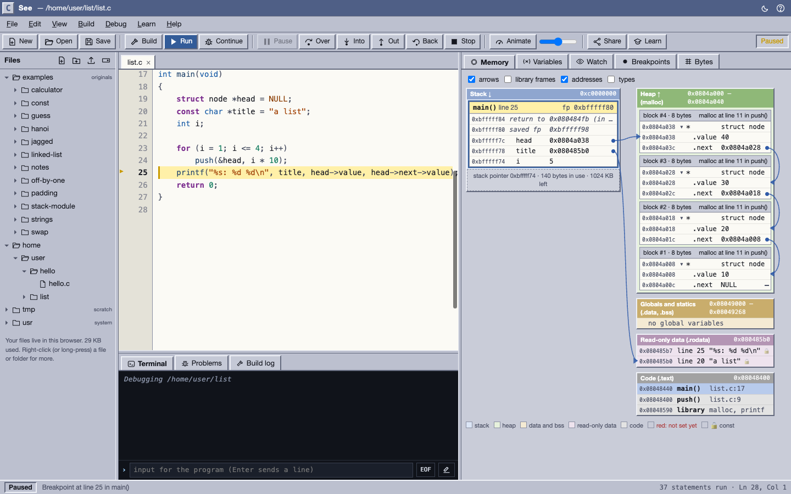

## What it does

See has its own C89 compiler, linker and C library, and runs programs on a simulated
32-bit machine laid out like a classic Unix system: code at `0x08048000`, then read-only
data, initialised data, zeroed data and the heap growing upwards, and the stack growing
down from `0xc0000000`. Function calls follow the i386 convention, so a frame really holds
the arguments, the return address, the caller's frame pointer and the locals, in that
order. Nothing is faked for the picture: the memory picture reads the same bytes the
program reads.

Write the program in the editor. **Build** (Ctrl+B) compiles every `.c` file in the
folder and links them. **Run** (Ctrl+F5) runs it at full speed; its output goes to the
terminal, and when it reads with `scanf` or `getchar` you type the input there. **Debug**
(F5) starts it paused at `main`. Step over a line with F10, into a call with F11, out of a
function with Shift+F11, and back with F8.

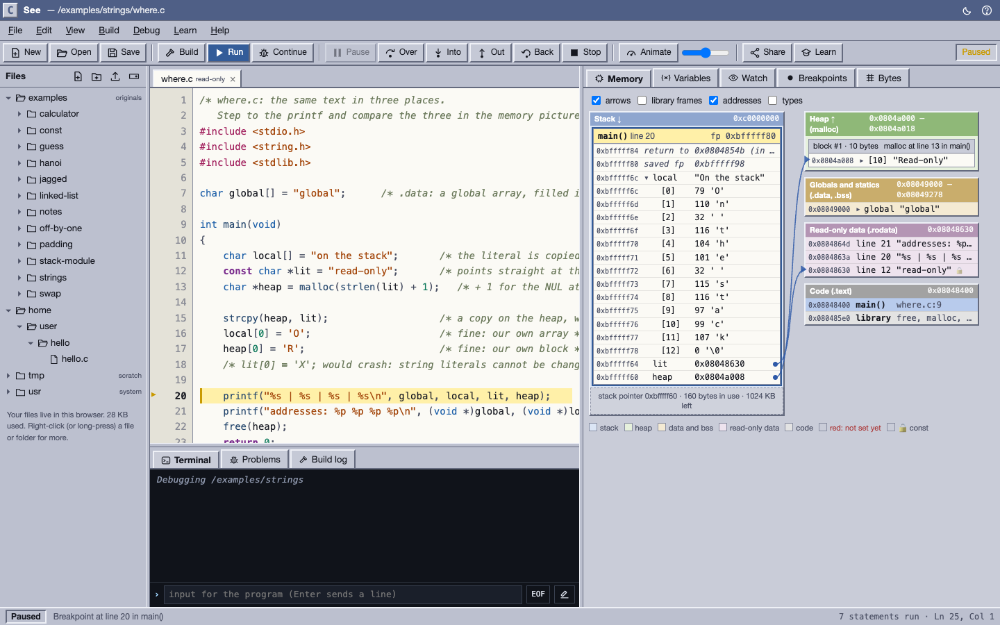

## The memory picture

The left column is the stack. The frame of `main` is at the top, near the high addresses;
each call adds a frame below the one that called it, because the stack grows down. Each
frame shows its parameters, the return address (and which function it returns into), the
saved frame pointer, and the local variables, each at its address.

The right column is everything else, from high addresses to low: the heap with every
block, its number, its size and the line that allocated it; the globals and static
locals, in `.data` when they start with a value and in `.bss` when they start at zero;
the read-only data, with every string literal and every `const` global; and the code,
with the address of every function.

A value that has not been set yet is shown in red, and it holds whatever was left in that
memory, as it would on a real machine. A value that just changed is yellow. `const`
values carry a padlock. Arrays and structs open with a click, down to every element and
member at its own address. A pointer to the start of a heap block shows the whole block
typed by the pointer, so `int *p = malloc(5 * sizeof(int))` shows five ints, not twenty
bytes. Freed blocks are hatched, and blocks nobody freed are reported as leaks when the
program ends.

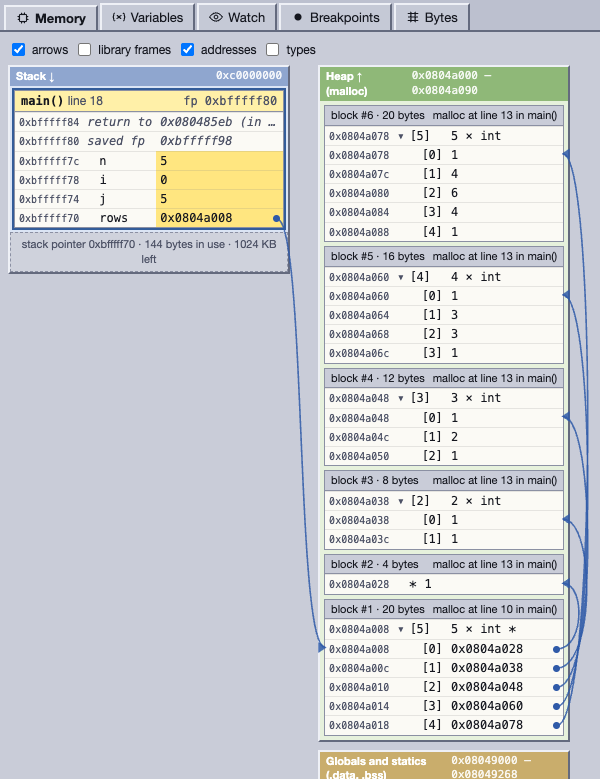

Function pointers point into the code segment, so a dispatch table shows each entry
pointing at its function.

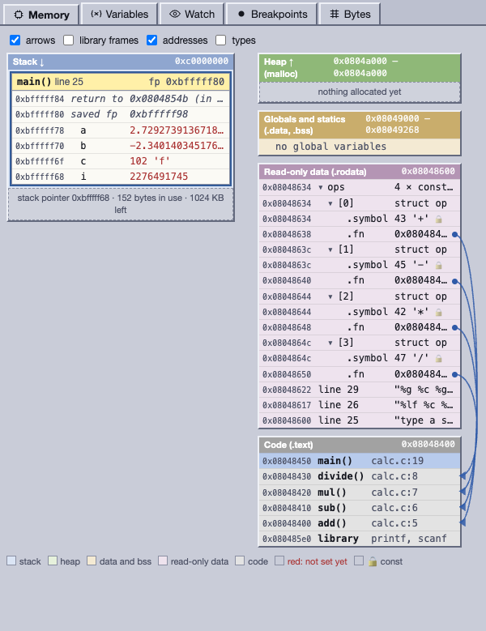

## The debugger

Click left of a line number to set a breakpoint, or press F9. Right-click it to make it
stop only when a C expression is true, such as `i == 5 && p != NULL`. **Run to the
cursor** (Ctrl+F10) stops on the line you are on. **Animate** steps by itself at the speed
of the slider, which is a good way to watch a sort or a recursion unfold.

Point at a variable in the editor while the program is paused, or at a chain like
`p->next->value` or `a[i]`. A card shows its value, type, address and the line that last
wrote it, and you can change it there.

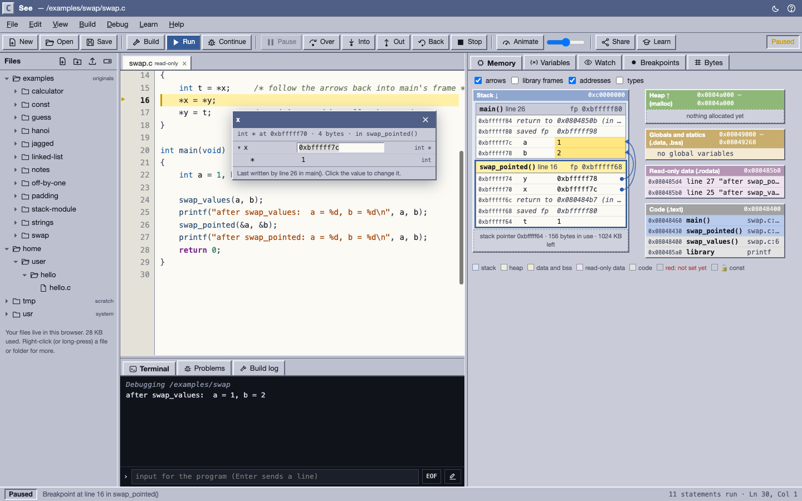

The **Variables** panel lists every frame on the stack. Select an older frame, such as an
earlier level of a recursion, and you see and change that frame's own copies of its
variables.

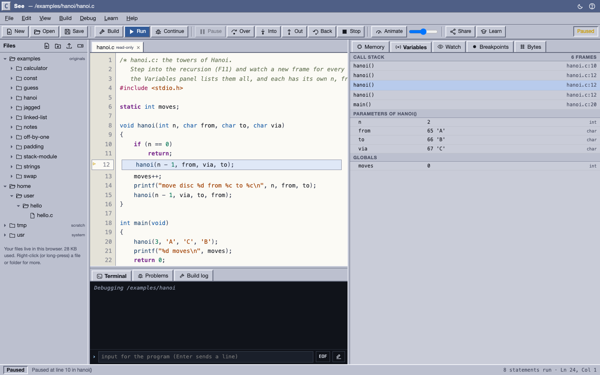

The **Watch** panel takes any C expression and works it out again at every stop. The eye
button next to a watch turns it into a watchpoint: the program stops whenever that memory
changes, whichever line changes it. The **Bytes** panel shows raw memory, sixteen bytes to
a row, each byte coloured by what it is (not yet set, read-only, heap bookkeeping, freed,
a frame's links); pointing at a byte tells you which variable it belongs to and which line
wrote it last.

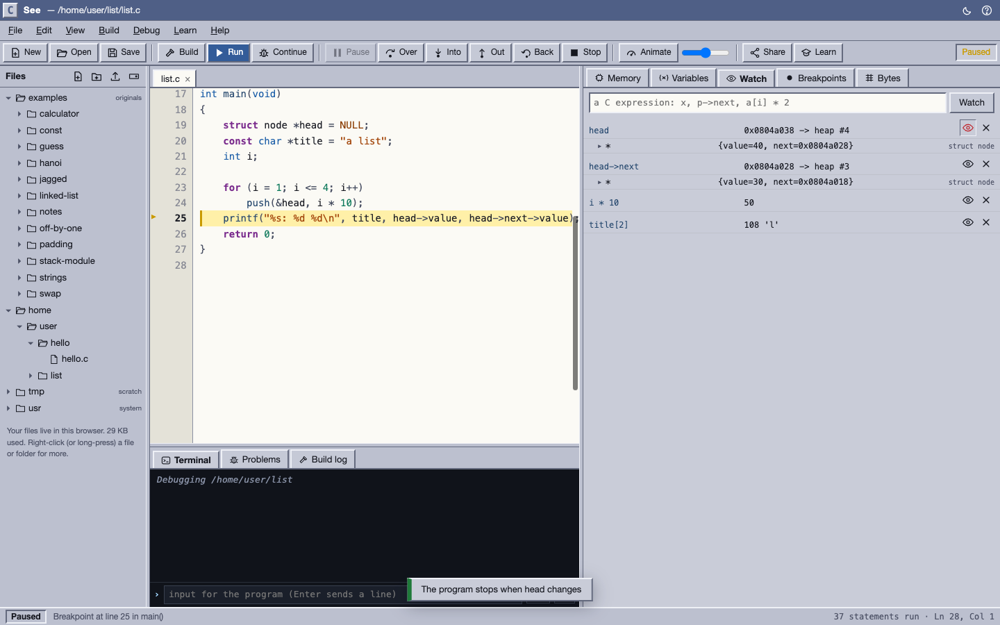

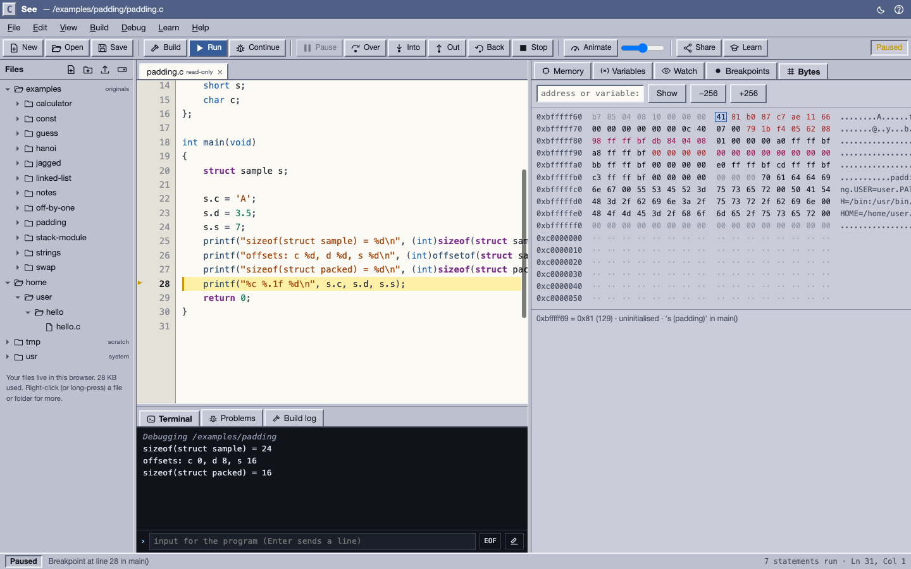

## Stepping backwards

While you debug, See records every step. F8 takes you back one line, and everything goes
back with it: memory, the heap, the frames, the input the program read and the output it
printed. Shift+F8 goes back one statement. This is most useful after a crash: the program
stopped on one line, but the mistake was made earlier, so you step back until you see the
bad value being made.

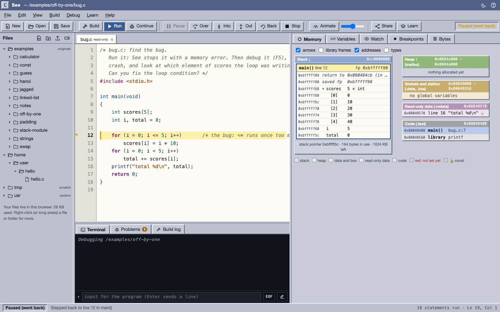

## Catching mistakes

Every load and store is checked, byte by byte, against what that memory is. When a
program goes wrong, See stops it at the exact statement and says what happened in words:

- a NULL pointer dereference;
- writing or reading one element past the end of a local array, or before its start;
- writing past the end of a `malloc` block, even by one byte, or into the heap's own
  bookkeeping;
- using a block after `free`, freeing it twice, freeing a pointer into the middle of a
  block or to a stack variable;
- following a pointer to a local variable of a function that has returned;
- writing to a string literal or any other read-only data;
- a stack overflow from runaway recursion, and an overwritten return address;
- integer division by zero, and `INT_MIN / -1`.

It also warns, without stopping, when the program reads a variable that has never been
given a value, when a signed integer overflows, when a function falls off its end without
returning a value, and about every block still allocated when the program ends. The
memory picture at the moment of the crash shows the culprit.

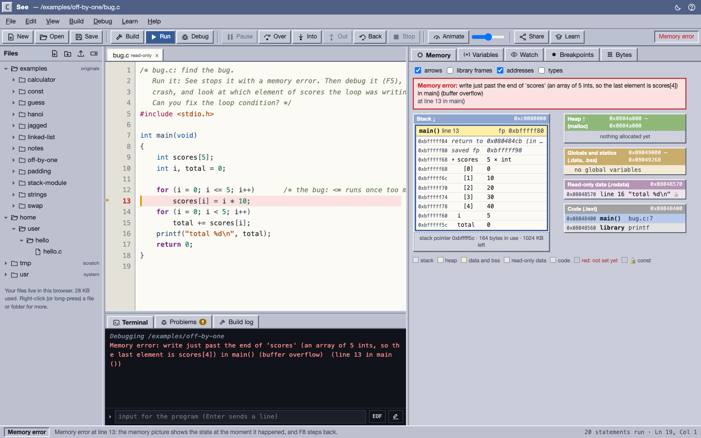

The compiler warns the way gcc does with `-Wall`: implicit declarations, unused variables,
`printf` and `scanf` arguments that do not match the format (including the forgotten `&`),
assignments that discard `const`, `=` where `==` was meant, comparing strings with `==`,
and more. Errors and warnings are listed under **Problems**; double-click one to go to the
line.

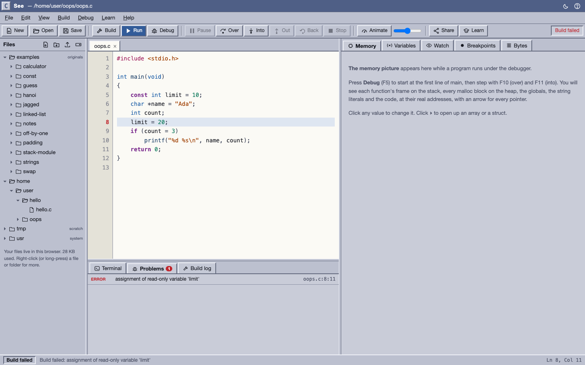

## Learning C

The **lessons** go from the first `printf` to pointers to pointers, in fifteen units and a
hundred lessons: types and their sizes, decisions and loops, functions and the stack,
arrays, pointers, `const` in every position, strings, `malloc` and `free`, structs and
unions, linked structures, function pointers, the preprocessor and programs in several
files, where everything lives in memory, the standard library, and how to catch bugs.
Each lesson is a short program and a walk through it. Every step moves the debugger and
explains what just happened, while the memory picture changes beside it. You can stop
anywhere, change a value, edit the code and carry on.

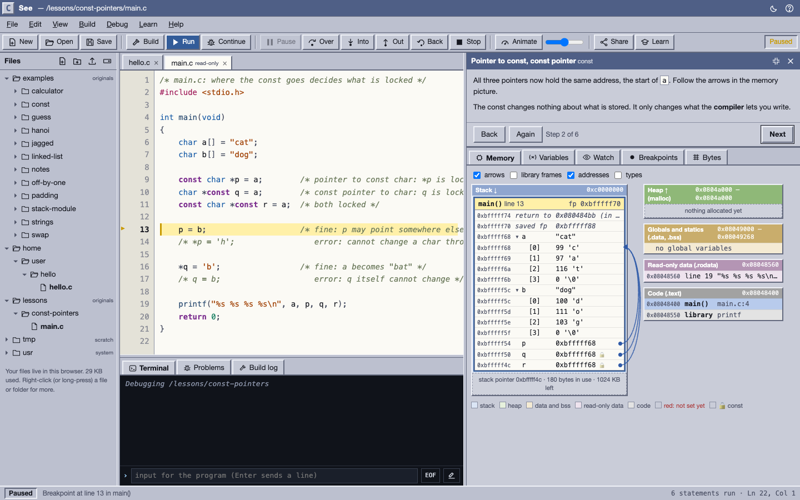

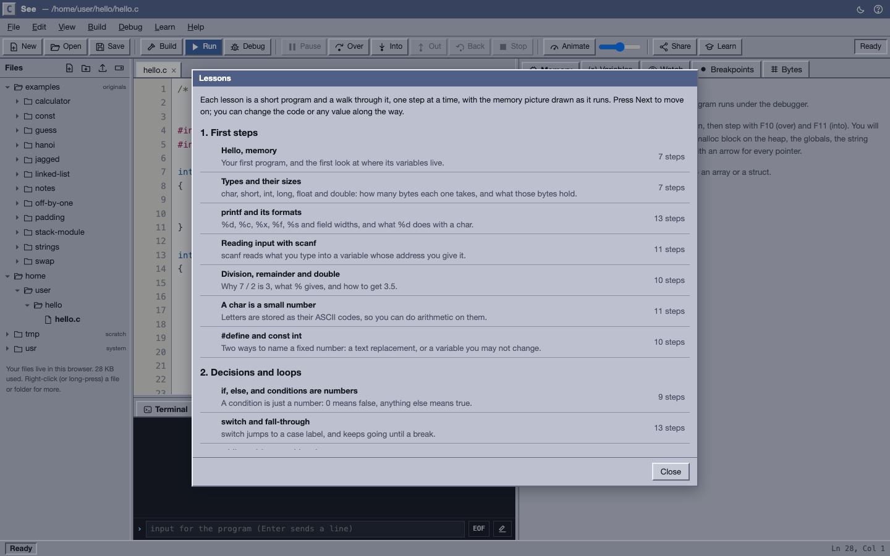

The **example library** has more than six hundred commented programs in twenty-two
categories: first programs, loops, functions, recursion, arrays, strings, pointers,
`const`, memory layout, dynamic memory, structs, data structures, sorting and searching,
function pointers, the preprocessor, the standard library, files, games, numbers and
maths, the classic exercises from the K&R book, programs in several files, and a "find the
bug" section where every program has one classic mistake for See to catch. Programs that
read input come with their answers, so they can be run as they are.

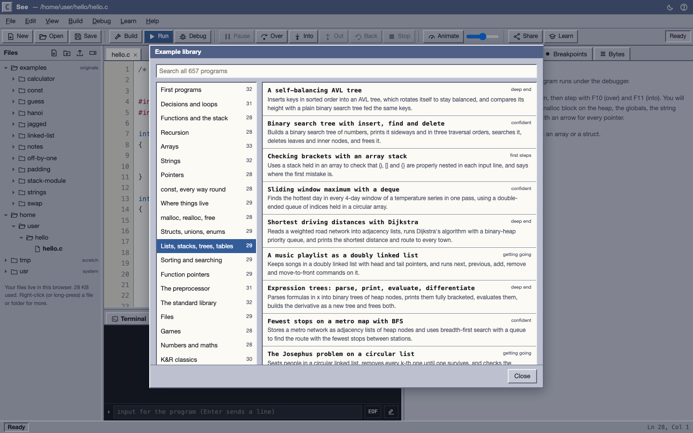

The **C reference** (F1) covers every function, macro, type and constant of the C89
library, every keyword and operator, and the ideas that come up again and again, such as
sequence points, integer promotion and storage duration. Each entry explains the traps,
and most have an example you can open and run with one click. Pointing at a library
function in the editor shows its prototype.

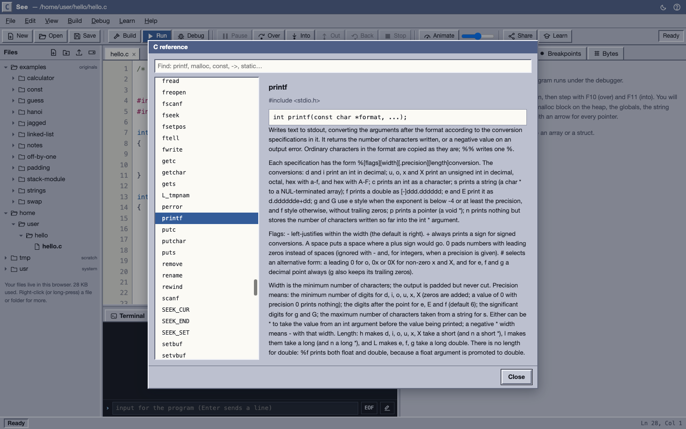

The **guided tours** walk through the studio itself: a first look, the debugger in depth,
files and sharing, and how to read the memory picture.

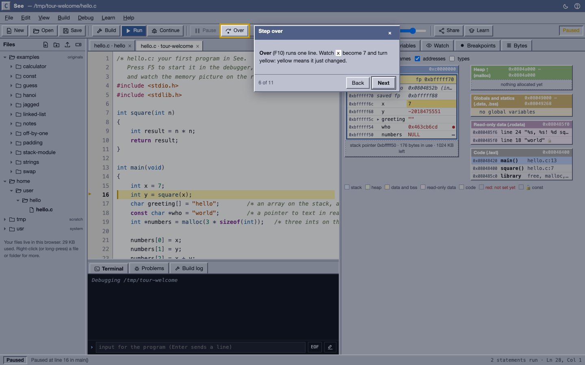

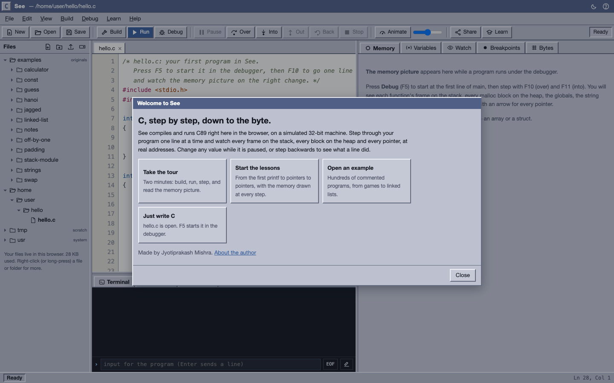

## Files, projects and sharing

Your files live in the browser, under `/home/user`. A folder is a project: every `.c`
file in it is compiled and they are linked together, so `extern`, `static`, include
guards and link errors all behave as they do with a real compiler. The real C89 headers
that the compiler uses are under `/usr/include`, and you can open `stdio.h` and read it.
`/examples` holds small projects that each show one idea. The examples, the library and
the lessons are originals: change one and saving makes a copy of your own.

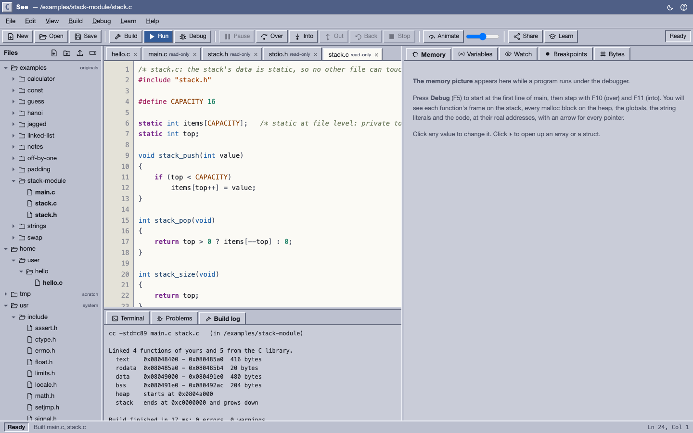

Programs can create, read and write files with `fopen` and friends. In Chrome and Edge
you can also give See a folder from your computer, choosing whether programs may only
read it, must ask before each change, or may write freely.

**Show the preprocessed file** shows a file after `#include` and macros, and **Show what
the linker made** lists every function, object and string literal with its address.

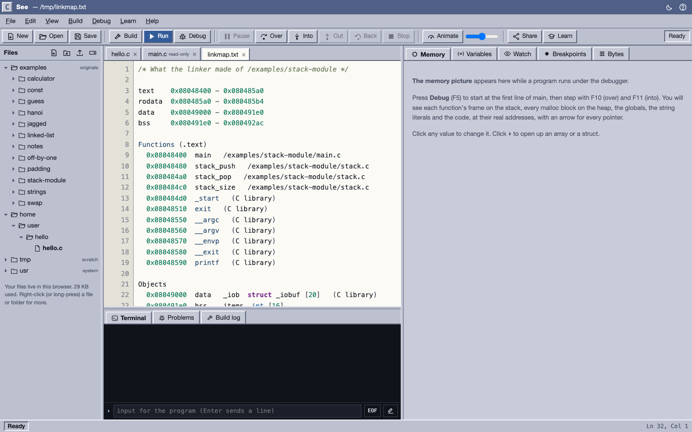

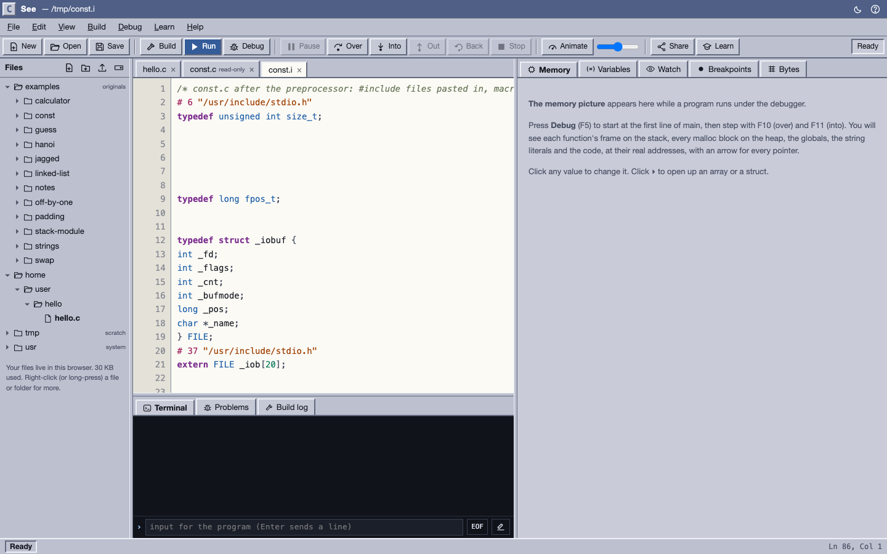

**Share** packs a project into a link. Everything is inside the link itself, compressed;
nothing is uploaded anywhere. Whoever opens it gets their own copy to change. Projects can
also be downloaded as a zip.

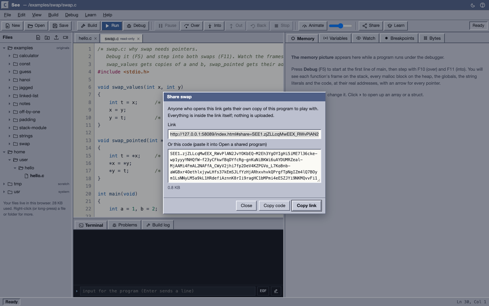

## The terminal

Standard output and standard error go to the terminal, errors in red. When the program
waits for input, the prompt blinks and you type a line; the EOF button (or Ctrl+D) ends
the input. Output that is still in `stdout`'s buffer while the program is paused shows
dimmed, because that is where it really is until a newline, a `fflush` or the end of the
program. If the program crashes with output still buffered, See says what was lost. The
terminal can be plain, green phosphor or amber.

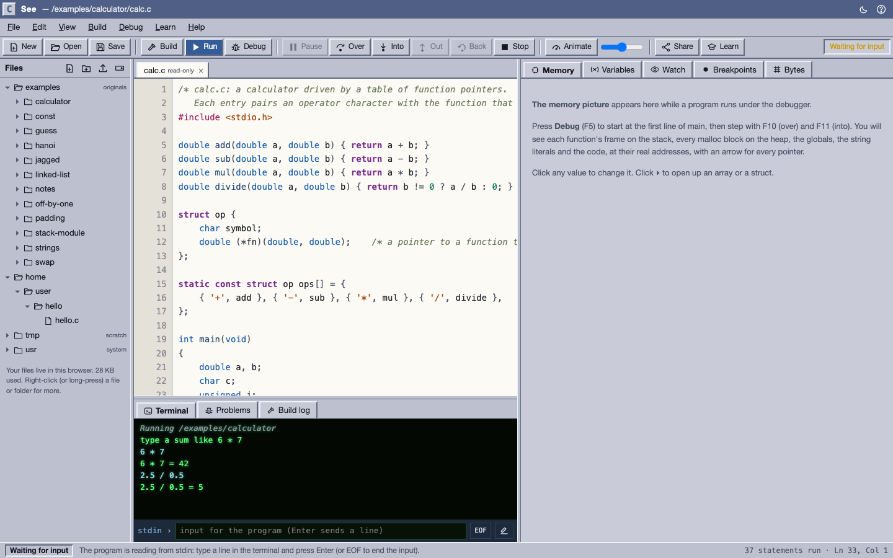

## Looks

The studio looks like a Unix workstation of the late 1980s, with raised and sunken
bevels, in a light grey palette and a dark one. It follows the system's setting until you
choose.

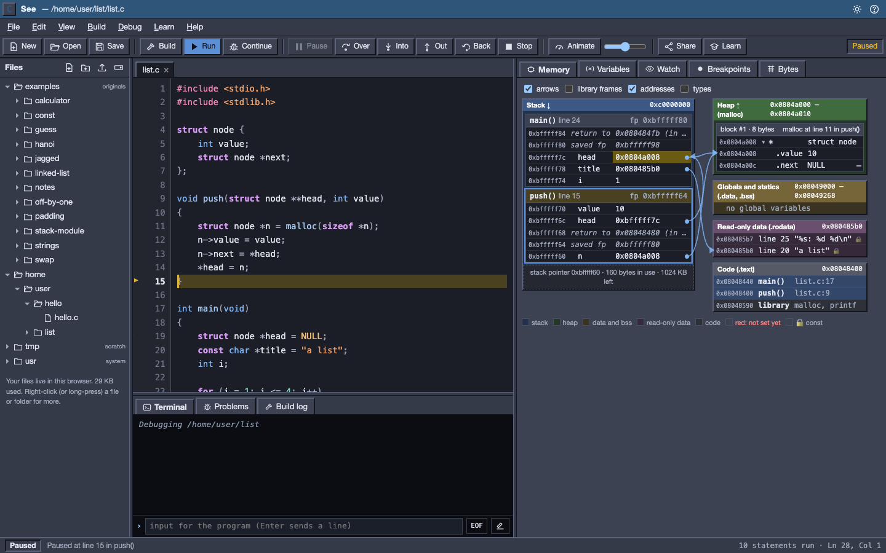

## Phones and tablets

On a phone the studio becomes four views (Files, Code, Run and Memory) with a bar to
switch between them, and the memory picture becomes a single column. Debugging keeps the
code in view, and a small bar keeps the lesson's Next button at hand. On a tablet
everything fits side by side. Touch works everywhere: a tap on a variable shows its value,
and a long press on a file opens its menu.

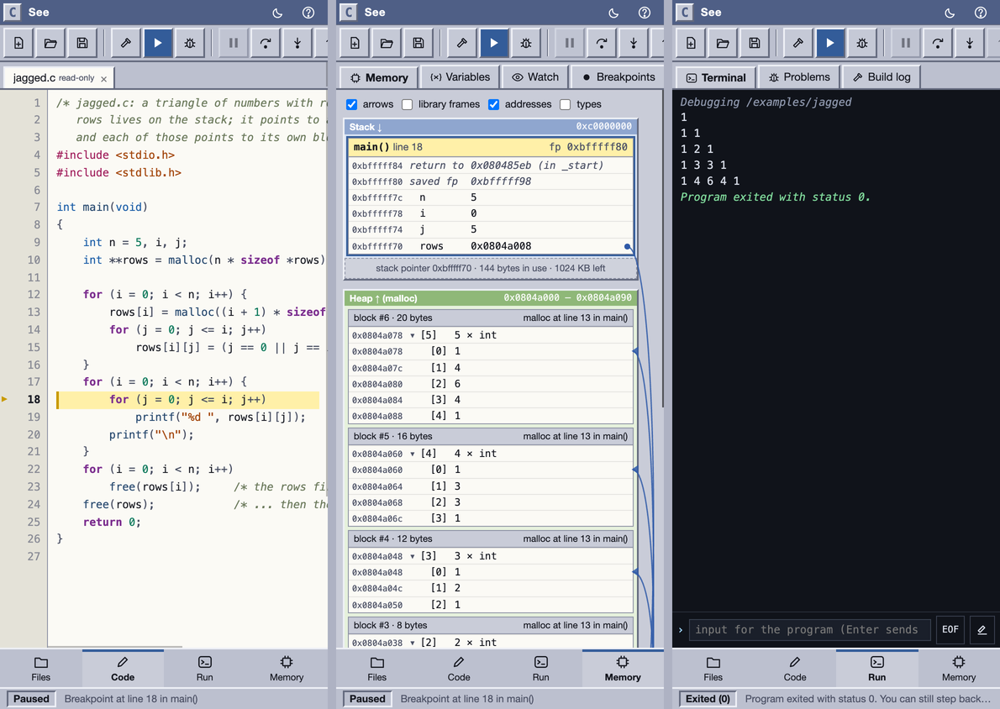

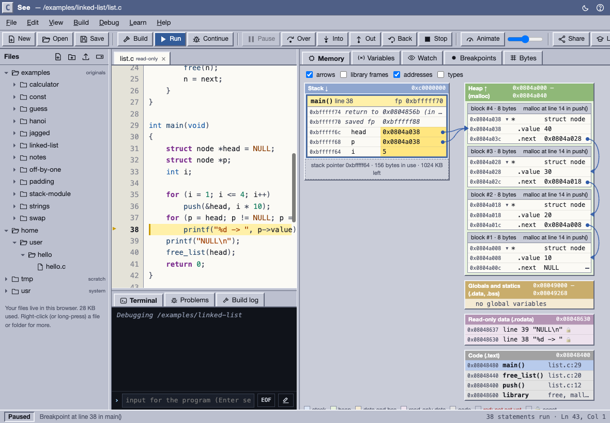

## The C it understands

See implements C89 (ANSI X3.159-1989, ISO/IEC 9899:1990) as a compiler would, not as an
interpreter that guesses:

- the whole preprocessor: `#include` of project and system headers, object-like and
  function-like macros with `#` and `##` and the rescanning rules, `#if` arithmetic with
  `defined`, `#elif`, `#line`, `#error`, `__FILE__`, `__LINE__`, `__DATE__`, `__TIME__`
  and `__STDC__`;
- all the types: `char`, `short`, `int` and `long` in signed and unsigned forms, `float`,
  `double` and `long double`, pointers to anything, arrays of any dimension, structs and
  unions with bit-fields, enums, typedefs, and function types with prototypes or in the
  old K&R style;
- every declarator C allows, such as `int (*(*fp)(int))[10]`, with `const` and `volatile`
  in every position, and the qualifier checks that go with them;
- initialisers for every kind of object, with brace elision and strings for char arrays,
  and constant addresses in static initialisers;
- all the operators with C's promotions and conversions, pointer arithmetic scaled by
  the element size, and `sizeof` of any type or expression;
- every statement, including `switch` with fall-through and `goto`;
- the complete C89 library in its fifteen headers: `stdio.h` with buffered streams,
  formatted input and output with every flag and conversion, files, `ungetc`, `fseek`;
  `stdlib.h` with a real heap allocator, `qsort`, `bsearch`, the conversions, `atexit`,
  `getenv`; `string.h`, `ctype.h`, `math.h` with `errno`, `time.h`, `setjmp.h`,
  `signal.h`, `stdarg.h` (whose `va_arg` walks the arguments on the stack exactly as the
  classic macros do), `locale.h`, `assert.h`, `limits.h`, `float.h`, `stddef.h` and
  `errno.h`.

The machine is a 32-bit little-endian one: `char` is 1 byte and signed, `short` 2, `int`
and `long` 4, pointers 4, `float` 4, and `double` and `long double` 8. Function arguments
are evaluated right to left, as gcc does on that machine, which matters only in programs
that should not depend on it. `//` comments and declarations after statements are
accepted with a warning, because so much C is written that way, but other C99 features
(`for (int i...`, designated initialisers, `long long`, `snprintf`) are errors.

## Keyboard

| Key | Does |
| --- | --- |
| F5 | Debug: start paused at main, or continue |
| Ctrl+F5 | Run at full speed |
| Shift+F5 | Stop |
| F10 / F11 / Shift+F11 | Step over, into, out |
| Ctrl+F11 | One statement |
| F8 / Shift+F8 | Step back a line / a statement |
| Ctrl+F10 | Run to the cursor |
| F9 | Breakpoint on this line |
| Ctrl+B | Build |
| F1 | The reference for the word under the cursor |
| Ctrl+S, Ctrl+N, Ctrl+O | Save, new file, open |
| Ctrl+F, Ctrl+H, Ctrl+G | Find, replace, go to line |
| Ctrl+/ | Comment or uncomment the lines |
| Ctrl+D | In the terminal: end of input |

## Running it locally

There is nothing to install. Serve the folder with any static file server, for example

```
python3 -m http.server 8080 --bind 127.0.0.1
```

and open http://127.0.0.1:8080/. Opening `index.html` straight from the disk works too,
except for the example library, whose programs are fetched from the `library` folder when
you open one, and real folders from your computer.

To rebuild `index.html` from the sources you need Node 20 or newer, and no packages:

```
npm run build
```

## How it is built

The source is plain JavaScript with no framework and no dependencies. The build script
inlines everything into one `index.html`, which is what GitHub Pages serves; the library
is an index in the page plus the programs in `library/`.

A build goes through the stages a C compiler goes through. The lexer and the preprocessor
work on tokens that remember their file, line and column, with hide sets for macro
expansion as the standard describes them. The parser checks types as it goes and builds a
typed tree, folding constants and reporting errors in the words gcc uses. The code
generator turns each function into bytecode for a stack machine, and the linker lays out
text, read-only data, data and bss at fixed addresses, resolves names across files (with
"undefined reference" and "multiple definition" errors), pulls in the parts of the C
library a program uses, and patches the addresses into the code. Part of the C library is
written in C and compiled the same way (program start-up, `exit` and `atexit`, `qsort`,
`signal`), and the rest is written in JavaScript against the same checked memory.

Memory is a byte array with a shadow byte for every address, which says what that byte is:
code, read-only data, initialised, not yet initialised, heap bookkeeping, a guard gap,
freed, or a frame's links. Every load and store checks it, which is how mistakes are caught
at the exact byte. The heap allocator keeps real headers in memory in front of each block.
While debugging, every changed byte is journalled with its old value, its old shadow and
the statement that wrote it, so stepping back is a matter of rolling the journal back to
a checkpoint, and "which line wrote this" is always known. The machine hands control back
to the page every few milliseconds, so a program that never ends never freezes the page.

## Testing

`npm test` runs the language tests, which compile and run C programs and compare their
output, their compiler errors and warnings, and the crashes See reports, with what each
program says it should do; and the debugger tests, which step, set breakpoints, change
values and step back through programs. The content has its own checkers:
`node tools/check-lib.mjs` builds and runs every library program with its input,
`node tools/check-lessons.mjs` walks every step of every lesson and checks where the
debugger is, what the variables hold and what was printed, and `node tools/check-ref.mjs`
runs every example in the reference.

The end to end tests under `tests/e2e` drive the real built page in headless Chrome
through the DevTools protocol, with real mouse, keyboard and touch input. There are about
3,000 of them, and they cover the editor,
files and sharing, building and running, the terminal, the debugger and every panel, the
memory picture, stepping back, menus and shortcuts, themes, layouts for phones and
tablets, every dialog, every lesson, every tour, every reference example and every library
program. Any error on the page fails a test.

```
npm test
node tests/e2e/run.mjs
node tests/e2e/run.mjs --spec 50-debugger
```

The screenshots in this README are taken by `node tools/shoot.mjs` from the built page.

## Project layout

```
src/core         small helpers and the virtual disk
src/c            lexer, preprocessor, types, parser, code generator, linker,
                 memory, machine, C library, headers, debugger support
src/ide          the studio: editor, terminal, memory picture, debugger panels,
                 files, library, lessons, tours, reference, themes
samples          the small projects in /examples
library          the example library, one folder per category
assets           the photo on the About the author page
tests            language and debugger tests, and the headless end to end tests
tools            build helpers, checkers, the Chrome driver, screenshots
```

## Limitations

See is a teaching machine, not a production compiler. It does not optimise, so a program
runs a few hundred times slower than native code; a sieve of a few million numbers takes
seconds. Wide characters are limited to the "C" locale, where every multibyte character is
one byte. Signals cannot interrupt a running program from outside; `raise` and the default
actions work. There is no floating-point exception state, and `long double` is the same
as `double`.

## Trademarks

UNIX is a registered trademark of The Open Group, and Motif and CDE are trademarks of The
Open Group. Linux is a registered trademark of Linus Torvalds. Intel and x86 are
trademarks of Intel Corporation. Chrome is a trademark of Google LLC, Edge and Windows are
trademarks of Microsoft Corporation, and GitHub is a trademark of GitHub, Inc. These names
are used only to describe compatibility and history. See is an independent implementation
of the C language and its library, it contains no code from any compiler or C library, and
it is not affiliated with or endorsed by any of these organisations.

## License

See is free software under the GNU General Public License, version 3 or later. See
`LICENSE` for the full text and `COPYRIGHT` for the notice.

Under section 7 of the license there is one additional term, written out in full in
`NOTICE`. Any copy, modification or derived work, including a hosted version, must keep the
attribution "Based on See by Jyotiprakash Mishra (https://see.jyotiprakash.org)" in its
source and show it in its about screen or other legal notices. This applies to the program,
the lessons, the reference and the programs in the library and the examples.

Copyright (C) 2026 Jyotiprakash Mishra
